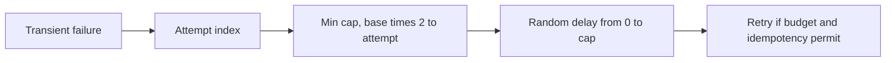

# Microservices Resilience Patterns

Java 17 examples of resilient distributed calls.

## Run

```bash
mvn clean verify
```

## Implemented

- `ExponentialBackoff.delay` calculates capped exponential delays with full jitter.
- JUnit 5 verifies the output stays inside its expected bounds and validates invalid input.
- GitHub Actions Maven verification workflow.

## Algorithm



**Important:** A retry is safe only if the operation is idempotent or protected with an idempotency key. Use overall deadlines and a bounded retry budget; otherwise retries can amplify downstream overload. This class calculates delays but does not make network calls or implement a circuit breaker.

## Next implementation milestones

- Spring Boot HTTP client with explicit connect/read timeouts.
- Resilience4j circuit breaker, bulkhead, bounded retries, and fallback.
- WireMock-based failure scenarios and circuit-breaker state transition tests.

## Interview prompts

What is retry amplification? Why add jitter? When should a circuit breaker move to half-open?
